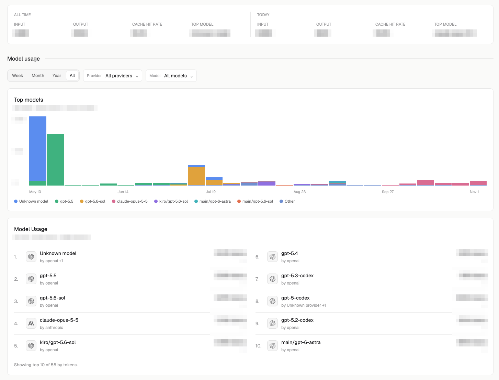

# Insights

A mod for the [Herdr](https://herdr.dev) desktop app: a local token-usage dashboard for coding agents. It reads the session transcripts that Pi, Codex, OpenCode, Claude Code, omp, omo and Prime Agent leave on your disk and shows lifetime totals, a year-long heatmap of tokens per day, a weekly chart of your top models and a top-10 model leaderboard.



## What it reads and runs

Nothing leaves your machine; it makes no network requests. It runs `node` on its own `presenter.mjs`, which reads:

- `~/.claude/projects`
- `~/.codex/sessions` and `~/.codex/archived_sessions`
- `~/.local/share/opencode`
- `~/.pi/agent/sessions`
- `~/.omp/agent/sessions`
- `~/.omo/agent/sessions` and `~/.omo/agent/projects`
- `~/.prime/agent/sessions` and `~/.prime/agent/session-artifacts`

All seven are enabled in new configurations; existing source configurations are preserved.

It stores token counts with their day, session, model, provider and project folder under `~/.config/herdr-app/data/insights/`, never prompts or code. That store can grow to tens of MB.

## Install

Ask your agent to add this repo as a Herdr mod, or do it yourself:

```sh
cp -R mods/insights ~/.config/herdr-app/mods/
herdr-app do tab.new '{"name":"Insights","mod":"insights"}'
```

## Requirements

Node 22.15 or later on the `PATH` Herdr sees (needed for Codex's `.zst` files and OpenCode). If Herdr can't find it, put `{"node": "/full/path/to/node"}` in `mods/insights/runtime.json`.

## Caching and filtering

The last matching dashboard appears immediately while sessions refresh in the background. Unchanged JSONL files are skipped; growing files read only appended bytes. Filter changes use cached aggregated rows, and identical requests reuse the prepared dashboard. The Agent filter includes OpenCode alongside the existing Provider and Model filters; lifetime metrics remain unfiltered.

Two private, disposable sidecars sit beside `insights.json`: `insights.json.snapshot.json` and `insights.json.dashboard.json`. They invalidate automatically and can be deleted safely. The authoritative store format is unchanged.

Checks: `node --test mods/insights/cache.test.mjs` and `herdr-app check mods/insights`. See [CHANGELOG.md](CHANGELOG.md) for dated changes.

## Known limitations

- The store is saved only after a whole scan finishes, and Herdr stops a mod's program after 30 seconds. A first scan of a very large history that takes longer than that is never saved.

See "Watch out" in [RECIPE.md](RECIPE.md) for details.

## License

[MIT](LICENSE)
