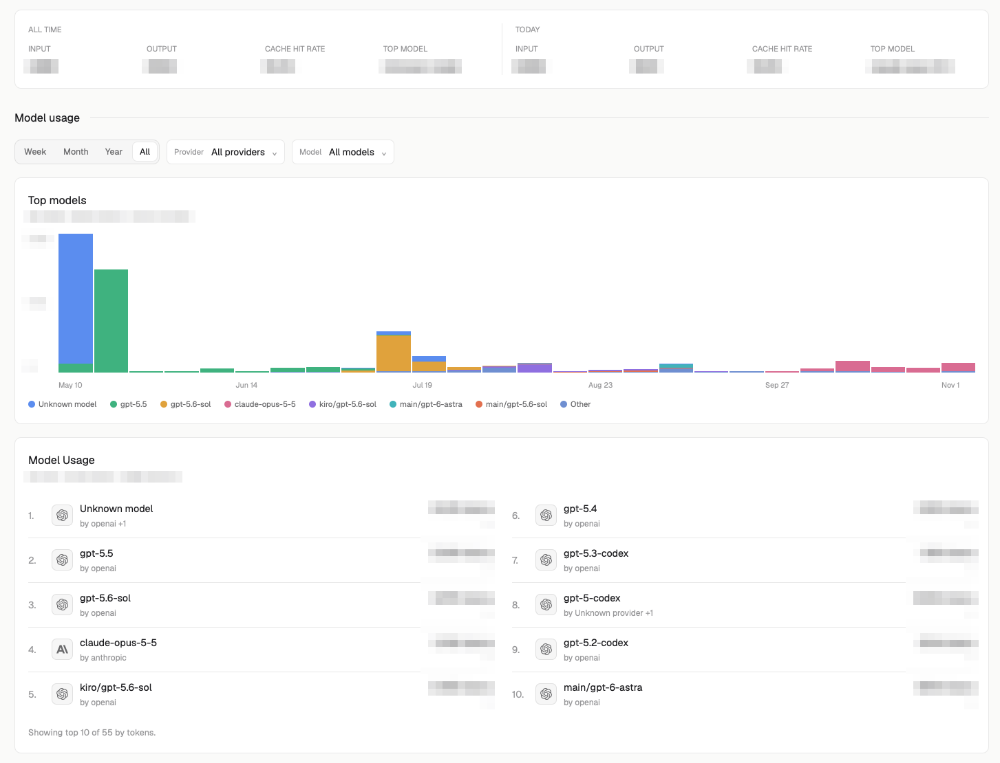

# Insights

A local token-usage dashboard for coding agents, drawn natively in Herdr. It reads the session transcripts that Pi, Codex, OpenCode and Claude Code leave on your disk. It then shows lifetime totals, a year-long GitHub-style heatmap of tokens per day, the selected day next to all time, a weekly stacked chart of your top models, and a top-10 model leaderboard with change against the previous period. Nothing leaves the machine. It sends no network requests, and it stores only token counts with their day, session, model, provider and project folder, never prompts or code.



## What you see

One scrolling column on the theme's `canvas` color. The content is centered, at most 1180px wide, with 24px padding (16px under 900px wide, 12px under 620px). Cards are `surface` with a 1px `border` and 8px radius. Controls are 30px high with a 6px radius. Type sizes: page title 20, card title 13.5, metric 22, value 12.5, body 11.5, small 10.5, uppercase labels 9.5. Every color comes from the Herdr theme (`canvas`, `surface`, `raised`, `popover`, `solid`, `foreground`, `muted`, `dim`, `hover`, `selected`, `accent`, `blocked`, `done`, `border`, `input`), except the heatmap and chart colors listed below.

Top to bottom:

1. **Header.** `Insights` (or `Settings`) on the left. On the right: a status line in `dim` (`Refreshing…`, `Saving…`, `Preparing…`, `Updated Today 14:05`, `Updated Yesterday 09:12`, `Updated Nov 3, 18:40`; `Showing last snapshot`, `Unavailable` or `Could not prepare dashboard` in the `blocked` color), an outline `↻ Refresh` button (disabled while busy), and an outline `Settings` / `Dashboard` button (shown once a snapshot exists).
2. **Metric strip.** One card with five stats divided by hairlines: `LIFETIME TOKENS` (compact, e.g. `1.24B`, note `N sessions · all time`), `PEAK DAY` (tokens, note `Mar 14, 2026`), `LONGEST TASK` (`42m`, `3H 5m`, `1D 2H`; note `Observed span`), `LONGEST STREAK` (`12D`), `CURRENT STREAK` (`3D`, drawn in `accent` when above 0). It is one row from 860px wide, 3 per row from 560px, otherwise 2 per row. Each value has a tooltip with the exact number.
3. **"No usage found yet"** card, shown only when no rows exist. It lists up to 4 enabled source roots and has an `Open settings` button.
4. **Section rule `Token usage`.** 13.5px semibold title followed by a 1px `border` line.
5. **`Tokens History` card.** A segmented `Daily` / `Weekly` / `Cumulative` control sits at the top right. Below it is a 53-week × 7-day grid ending in the current week. Cells are 12–20px square, sized to fit the width, with a 2px gap and 2px radius. A 30px weekday column shows every other label (`Sun`, `Tue`, `Thu`, `Sat`, or the Monday-first set), and a 15px row of month names sits above (names are left out for 1-week spans). The grid scrolls sideways when it doesn't fit and is centered when it does. Cell color has 5 levels (empty = `raised`, then quartiles of the window's maximum):
   - blue: dark `#12324f #155e8a #1d86c4 #4fb3f0`, light `#dbeafe #93c5fd #3b82f6 #1d4ed8`
   - green: dark `#12351f #166534 #15803d #4ade80`, light `#dcfce7 #86efac #22c55e #15803d`
   - purple: dark `#2a1b4d #4c1d95 #6d28d9 #a78bfa`, light `#ede9fe #c4b5fd #8b5cf6 #6d28d9`

   The dark set is used when the theme `background` has luminance under 128. Future days are `raised` at 30% opacity. The selected day has a 1px `accent` border. A legend at the bottom right reads `Less ▢▢▢▢▢ More` (10px squares) and `X in window`.
6. **Day detail card.** Two columns: `ALL TIME` and the selected day (`TODAY`, or e.g. `WED, NOV 4, 2026`). Each column shows `Input`, `Output`, `Cache hit rate` (cache reads ÷ (input + cache reads)) and `Top model`.
7. **Section rule `Model usage`.**
8. **Filter bar** (no card). A segmented `Week` / `Month` / `Year` / `All`. In Year mode a `‹ 2026 ›` stepper follows it. Then `Provider` and `Model` dropdown triggers (label in `dim`, value up to 132px, `⌄`; the border turns `accent` when a filter is set), and a ghost `Clear filters` button while any filter is set.
9. **`Top models` card.** Subtitle: `26 weeks · 3.1B tokens · cache included`. A stacked weekly bar chart, 168px high: the top 7 models plus `Other`, with a 28px y-axis (`max`, `max/2`, `0`) and a week label every ⌈weeks/6⌉ bars. Series colors are `#5b8def #3fb27f #e0a23c #d96c92 #8f6fe0 #41b3ba #e2704f`, and `Other` is `#6f8fd1`. Below the chart is a legend of 8px dots with names truncated at 180px. With no tokens in the window, the card shows `No model usage in this window.` instead.
10. **`Model Usage` leaderboard card.** Subtitle: `<range label> · tokens · sessions`. Up to 10 rows. Each row has the rank, a 26px `raised` tile with a 14px monochrome brand logo (or the model's initial), the model name, `by <provider>`, `<n> tokens`, and the change against the previous period. The change reads `↑+12.5%` in `done`, `↓-8.0%` in `blocked`, `New` in `accent`, or `0%` / `—` in `dim`. Two columns from 960px wide. A footer reads `Showing top 10 of N by tokens.`. When empty, it shows `No usage in this period` with a `Show all time` button.

**Settings view** (replaces everything below the header):

- `Preferences` card:
  - `Heatmap palette`: Blue / Green / Purple.
  - `Week starts on`: Sunday / Monday.
  - `Include cache tokens`: a 36×20 toggle.
  - `Refresh interval`: a 110px field followed by `sec`.
- `Sources` card: one inset per source, with an enabled toggle, its label, and a roots field (comma- or newline-separated).
- `Scan status` card:
  - Generated and last-scan times.
  - The error count.
  - `FILES` / `READ` / `UNCHANGED` / `BYTES`.
  - One row per source with a 6px status dot. The dot is `done` for Ok, `blocked` for Error or Missing, `accent` for Empty, and `dim` for Disabled. Disabled rows are at 55% opacity.
  - Up to 6 warnings, then `+N more warnings`.
- `Configuration JSON` card:
  - A 320px JSON editor with line numbers and syntax colors from `ansi1`–`ansi6`. It uses the `font_family` setting when one is set.
  - Outline `Format` and ghost `Reset` buttons.
  - A primary `Save configuration` button.
  - A message line: errors in `blocked`, `Configuration saved.` in `done`.

**Before the first snapshot**, a single state card takes the body. `Loading local insights` shows `Scanning 1,204 of 3,880 files` and the file being read. `Insights needs its collector` shows the error and a primary `Retry`.

## How it behaves

- It doesn't read agent status (working, blocked, done, idle). It only reads transcript files.
- **On open:** it reads the optional `runtime.json` to pick the Node binary. Then it runs a scan (`snapshot`) and repeats it every `refreshSeconds` (default 60, clamped 30–3600). The scan is incremental: unchanged files (same inode, size and mtime) are skipped, and growing JSONL files are read from the last offset.
- **During a scan:** the body polls the progress file every 500ms (up to 240 ticks) to show the file count and the current path. A refresh or save that takes over 35s is abandoned and reports `Refresh timed out after 35 seconds. Retry to try again.`
- **Refresh** runs a scan. **Retry** buttons rerun the step that failed. If a refresh fails after a snapshot exists, the old data stays on screen under a `Could not refresh insights` banner.
- **Heatmap:**
  - Clicking a past cell selects that day, and the day detail column switches to it.
  - Hovering a cell dims it to 80% and shows e.g. `Wed, Nov 4, 2026: 1,234,567 tokens · 3 sessions`. Weekly mode shows `Week of …`, cumulative mode `Through …`.
  - `Daily` colors each day by its own total. `Weekly` repeats the week total on all 7 cells. `Cumulative` is the running all-time total.
- **Scope:** the metric strip, heatmap and day detail always cover all data. The period and the Provider/Model filters scope only the Model usage section.
- **Periods:**
  - `Week` and `Month` run to today. `Year` runs Jan 1 to today, or to Dec 31 for past years.
  - Each period is compared with the same span one period back.
  - `‹` goes to an older year and `›` to a newer one, within the years that have data.
  - Changing the period moves the selected day to the period's end.
- **Filter menus:** each is a popover, 240px wide and up to 320px high, scrolling. The first entry is `All providers` / `All models`. After it come up to 250 values sorted by tokens, each with a compact token count and a `✓` on the selected one. Beyond that the menu reads `Showing top 250 by tokens.`. Picking a value closes the menu.
- **Filter changes** never rescan. They run the read-only `prepare` step against the saved store. While it runs, the header says `Preparing…`.
- **Settings:**
  - Toggles and segmented controls edit a draft, and the JSON editor reflects the draft. Edited JSON is applied to the fields when the editor loses focus.
  - Enter in a roots or interval field saves. `Save configuration` validates the draft, writes it and rescans.
  - Changing any source's id, adapter, enabled flag, roots or mapping clears the collected data and rebuilds it from scratch.
  - `Reset` restores the saved config. `Format` pretty-prints valid JSON.
- **Token math:** total = input + output + cache read + cache write. Cache is left out when `Include cache tokens` is off. Reasoning is counted inside output. Repeated or streamed copies of one message count once, at their highest values.
- **Longest task:** uses the duration the harness reports (Claude `turn_duration`, Codex `task_complete`, OpenCode completed − created). Otherwise it uses the span from prompt to final answer, capped at 2 hours.
- **Streaks:** count consecutive active days. The current streak still counts when the last active day was yesterday.
- **Commands** (to a shown copy, `insights.<command>`):
  - `refresh`, `settings`, `dashboard`
  - `period.week|month|year|all`
  - `year.prev` (older), `year.next` (newer)
  - `heatmap.daily|weekly|cumulative`
  - `filters.clear`

## Built from

- **Mod:** `mods/insights/` with `mod.json` = `{ "place": "none", "title": "Insights" }`. It has no `props`, no layout block, and no `keys.json`. Open it as a tab with `tab.new {name: "Insights", mod: "insights"}`, or place it in a layout block as `"content": { "mod": "insights" }`. `mod.open {name: "insights"}` does nothing as shipped, because `mod.json` describes no overlay; add `"overlay": { "width": …, "height": … }` to `mod.json` first if you want to open it that way or bind it to a key (`"cmd-shift-i": "mod.open:insights"`).
- **`main.js`** (QuickJS view, `export default class Insights extends View`):
  - `herdr`: `exec`, `appHome`, `home`, `theme`, `settings`, `nextCommand`, `readTextFile`.
  - `gpui-kit`: `View`, `div`, `svg`.
  - `gpui-base`: `v_flex`, `h_flex`, `Button`, `Input`, `InputState`, `Editor`, `EditorState`, `Popover`.
  - `cx`: `cx.spawn`, `cx.timer.every`, `cx.timer.after`.
  - `on_size_change` drives the breakpoints.
  - `close()` cancels every task and timer and releases the input and editor states.
- **`ui.js`:** the tokens and parts. It maps the theme onto shadcn-style roles (`primary` = `solid`, `ring` = `accent`, `destructive` = `blocked`) and provides the button family (primary / secondary / outline / ghost), the segmented control, the `Toggle` switch, the stat cell, the card / inset / state card, and the notice banner.
- **`analytics.js`:** pure functions shared by both sides. They cover dates (local calendar days, never UTC), formatting (`1.24B`, `3H 5m`), periods, filters, facets, streaks, peak day, heatmap, weekly model series and leaderboard. `compactDashboard` trims the payload to what the view draws, and `isPresentation` validates it.
- **Program run:** `node` only, through `exec`, always as `node <appHome>/mods/insights/presenter.mjs <command> --store <appHome>/data/insights/insights.json …`. The commands are:
  - `snapshot --home <home()> --options <json>`: scan, then derive.
  - `configure --home … --config <json> --options <json>`: validate, save, scan, derive.
  - `prepare --options <json>`: read the store read-only, then derive. It never scans.

  The options are `{filters, period, year, heatmapMode, selectedDay, today}`. The presenter prints one JSON object, `{kind: "insights-presentation", version: 1, snapshot, dashboard, error}`, so QuickJS never sees raw rows. The mod doesn't call `hc`, and it doesn't call `fetch` or any network API.
- **`collector.mjs`:** takes the store lock, loads the store, runs `scanSources`, saves, and builds the snapshot. It also runs standalone with `snapshot|configure --store <file> [--home <dir>] [--rebuild]`.
- **`core/config.mjs`:** strict config validation (unknown keys are rejected). The default config:

  ```json
  {
    "profile": { "name": "Developer", "handle": "", "avatar": "" },
    "palette": "blue",
    "includeCache": true,
    "weekStartsOn": 0,
    "refreshSeconds": 60,
    "sources": [
      { "id": "pi", "label": "Pi", "adapter": "pi", "enabled": true, "roots": ["~/.pi/agent/sessions"] },
      { "id": "codex", "label": "Codex", "adapter": "codex", "enabled": true, "roots": ["~/.codex/sessions", "~/.codex/archived_sessions"] },
      { "id": "opencode", "label": "OpenCode", "adapter": "opencode", "enabled": true, "roots": ["~/.local/share/opencode"] },
      { "id": "claude", "label": "Claude Code", "adapter": "claude", "enabled": true, "roots": ["~/.claude/projects"] }
    ]
  }
  ```

  Adapters are `pi`, `codex`, `opencode`, `claude`, and `custom`. A `custom` source needs a declarative `mapping` (`session`, `timestamp`, `usage`, and optionally `messageId`, `project`, `model`, `provider`, `role`/`roles`, `include`, `taskDurationMs`, `harness`; fields are dot paths, `{path, default}` or `{literal}`). A store saved with only the old three default sources gets Claude Code added.
- **`core/scan.mjs`:**
  - Walks each enabled root, matching `*.jsonl`, plus `*.jsonl.zst` for Codex and `opencode.db` for OpenCode. It doesn't follow directory symlinks, stops at 250,000 entries per root, and skips lines over 16 MiB.
  - Streams JSONL in 256 KiB chunks and keeps each file's offset.
  - Decompresses `.jsonl.zst` with `zlib.createZstdDecompress`.
  - Opens `opencode.db` with `node:sqlite` `DatabaseSync(path, {readOnly: true})` and `SELECT session_id, id, time_created, data FROM message`.
  - Keeps at most 50 warnings.
- **`core/adapters.mjs`:** the per-harness record parsers.
  - Pi: `session` header, `message` usage, `usage`/`compaction`/`branch_summary` carriers, sub-agent records.
  - Claude: `assistant` `message.usage`, `system`/`turn_duration`.
  - Codex: `session_meta`, `turn_context`, `token_usage_record`, `event_msg` `token_count` (cumulative and last), `task_complete`, with twin de-duplication.
  - Custom: the mapping.
- **`core/store.mjs`:** the JSON store at `<appHome>/data/insights/insights.json` (`version: 1`). It holds the config, per-file entries (path, inode, size, mtime, offset, rows), a de-duplication map with max-upsert per message, and task durations. A corrupt store is copied to `insights.json.corrupt-<timestamp>` and a fresh one is started.
- **`core/util.mjs`:**
  - Atomic writes (temp file, then rename; files 0600, folders 0700).
  - `~` expansion.
  - Timestamp parsing (seconds, ms, µs, ISO).
  - The store lock: a `insights.json.lock/` folder with an owner file. A lock left by a dead process on the same host is reclaimed. After 20 s of waiting the scan fails with `insights store is busy`.
- **Art:** `logos/*.svg`, ten one-color 24×24 brand marks tinted with `mutedForeground`: `openai`, `anthropic`, `googlegemini`, `deepseek`, `xai`, `meta`, `mistralai`, `amazonaws`, `opencode`, `ollama`. They are picked by model name first (`claude`, `gpt`/`o1`–`o9`, `gemini`, `deepseek`, `grok`, `mistral`/`mixtral`/`codestral`, `ollama`, `llama`), then by provider prefix (`aws`/`amazon`/`bedrock` map to `amazonaws.svg`).

## Watch out

- **Node is required, and `runtime.json` is optional.** `main.js` reads `<appHome>/mods/insights/runtime.json` (`RUNTIME_FILE`, main.js:134; read in `resolveRuntime`, main.js:645). Nothing in the mod writes or creates it. When the file is absent, `readTextFile` returns `null` and the mod runs plain `node` (`DEFAULT_NODE`, main.js:133) from the PATH that `exec` sees. Set `{"node": "/absolute/path/to/node"}` only when `node` isn't on that PATH. A version manager's shim can be missing from it when Herdr is launched outside a shell. If the file exists but isn't one JSON object with a non-empty `node` string, the mod stops with `Insights runtime configuration failed at …` and doesn't run anything.
- **Node version:** use Node 22.15 or newer. Older versions skip Codex `.jsonl.zst` files (`needs Node's zstd API (Node 22.15+)`) and, without `node:sqlite`, the OpenCode database, each with a scan warning.
- **`exec` has a 30 s limit** (herdr.d.ts), and the mod's own watchdog is 35 s. The collector saves the store only after the whole scan finishes. A first scan of a very large history that takes longer than 30 s is therefore never saved.
- **The folder name is hard-coded.** `mods/insights/presenter.mjs` (main.js:135), `mods/insights/runtime.json` (main.js:134), `mods/insights/logos/…` (main.js:1724) and `data/insights/insights.json` (main.js:679) are fixed paths. If the mod is renamed to avoid a name clash, change all four.
- **What it reads outside its own folder:**
  - The five default roots under the home folder, recursively: `~/.pi/agent/sessions`, `~/.codex/sessions`, `~/.codex/archived_sessions`, `~/.local/share/opencode`, `~/.claude/projects`.
  - Any roots added in Settings.
  - OpenCode's `opencode.db` (and the size of `opencode.db-wal`), opened read-only.
  - Missing roots are a note in the scan status, not an error.
- **What it writes:** only under `<appHome>/data/insights/`: `insights.json`, `insights.json.lock/`, `insights.json.progress.json` (removed after each scan), and `insights.json.corrupt-*` backups. The store keeps full project folder paths, session ids and transcript file paths, alongside token counts. It isn't trimmed: on one machine with a long history it reached 39 MB.
- **Network and programs:** it doesn't reach the network. The only program it runs is Node with the mod's own `presenter.mjs`.
- **No key ships.** A `"none"` mod appears only where something opens it. Use `tab.new` with `mod: "insights"`, or a layout block.
- **Accepted but not shown:** `profile.name`, `profile.handle` and `profile.avatar` are validated in the config but never drawn.
- **Placeholder:** the source roots field shows `~/.harness/sessions` when empty. It's only placeholder text.
- **Limits:**
  - 10 leaderboard rows.
  - 7 chart models plus `Other`, over 26 weeks.
  - 53 heatmap weeks.
  - 250 entries per filter menu.
  - 6 warnings shown in the status card (50 kept).
  - Refresh interval 30–3600 s.
  - `readTextFile` reads at most 1 MiB, but it is used only for `runtime.json` and the progress file.
- **Local days:** every day boundary uses the machine's local time zone. Changing the time zone moves usage between days on the next rebuild.

## Done when

- `herdr-app check` passes for `mods/insights`.
- With no `runtime.json` and `node` on PATH, opening the mod (`tab.new {mod: "insights"}`) shows `Loading local insights` with a `Scanning N of M files` count. The dashboard follows, with the header reading `Updated Today HH:MM`.
- `<appHome>/data/insights/insights.json` exists after the first scan. No `insights.json.lock` folder or `.progress.json` file remains once the scan is done.
- `node mods/insights/presenter.mjs prepare --store <appHome>/data/insights/insights.json` prints one JSON object with `"kind":"insights-presentation"` and a non-null `dashboard`.
- Clicking a past heatmap cell outlines it in `accent`, and the second detail column changes to that day.
- Switching `Week` / `Month` / `Year` / `All` changes the leaderboard subtitle (e.g. `Week of Nov 1`, `November 2026`, `2026`, `All time`), while the metric strip and heatmap stay the same.
- Picking a model in the `Model` menu narrows the chart and leaderboard, gives the trigger an `accent` border, and shows `Clear filters`.
- In Settings, switching the palette to `Green` and saving shows `Configuration saved.`, and the heatmap uses the green set.
- Turning a source off and saving rescans, and that source's row in `Scan status` reads `Disabled`.
- Writing `{"node": 5}` to `runtime.json` and reopening shows `Insights needs its collector` with `runtime.json must contain a node string.`
- `insights.heatmap.weekly` sent to a shown copy switches the heatmap to `Weekly`.
